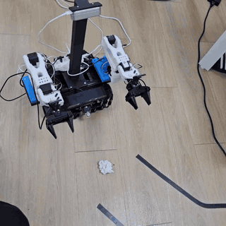
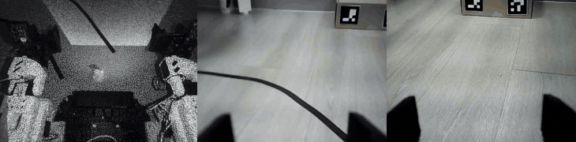

# SWEEPICK · 바닥 물체를 치우는 저비용 양팔 모바일 매니퓰레이터

청소 전에 바닥의 작은 물체를 집어 다른 곳에 옮겨 놓는 로봇이다. TurtleBot3 Waffle에 SO-101 양팔과 RGB-D·손목 카메라를 올렸다.
동국대학교 DAPIER 1기 Physical AI 과정의 4인 팀 프로젝트이며, 이 저장소에는 양팔 쪽 코드와 기록(SIM 데이터, ACT 학습·평가,
실물 연동, 베이스↔로봇팔 ROS 2 인계)이 있다. 이동 베이스의 Visual SLAM·Nav2·도킹은 [팀원 저장소](https://github.com/shouttt1320/Dapier_project_visaul_slam)에 있다.

<p align="center">
  
</p>

<p align="center"><sub>최종 발표 시연(4배속) · <a href="https://julianjeonresume.netlify.app/assets/video/sweepick-real-full-run.mp4">원본 영상 62초</a> · <a href="https://julianjeonresume.netlify.app/#demo">로봇 시점 ACT 실행</a> · <a href="https://julianjeonresume.netlify.app/#projects">포트폴리오의 WHY·PAAR</a></sub></p>

## 현재 동작과 남은 확인

| 영역 | 현재 상태 |
|---|---|
| 전체 과정 (실물) | 2026-11-01 사람 개입 없이 A 지점 도착 → 양팔 ACT 집기 → B 지점 이동·놓기 → HOME 복귀·토크 해제까지 처음 끝까지 성공 |
| 물체별 집기 (실물) | 작업공간 안 10회씩: 3 cm 큐브 7/10 · 휴지 8/10 · 원형 고무 7/10. 최종 발표 기준, 물체별 추가 파인튜닝 없음 |
| ACT 정책 (SIM) | 고정 epoch30, 143개 위치 각 1회 132/143(92.3%), Test 위치 27/31(87.1%). 시연이 없던 Train 위치 17/21 완료 |
| 학습 데이터 | SIM Expert로 만든 성공 113궤적 × 외형 5종 = 565뷰. 궤적 단위 train/val/test 59/29/25, 같은 궤적의 외형은 같은 분할 |
| 집기 판정·복구 (실물) | 카메라 대신 집게 서보 부하로 판정(잡았을 때 23–26 tick, 빈손 6–8 tick). 빈손이면 자동 회수 → 재접근 → ACT 재시작 |
| 베이스↔로봇팔 인계 | `/task/ack` · `/task/command`(1회 10 cm·30° 제한) · `/sweepick/ready` · heartbeat 2 Hz, 팔 작업 중 차체 잠금 |
| 남은 확인 | 청소·충전의 실물 연결, 같은 세팅에서의 연속 성공률 측정 |

SIM 완료 기준은 **30 mm 이상 Lift → Stow → 물리 2초 Hold**다. 외형(물체 색·배경/테이블 텍스처·조명)은 랜덤화하고 물체 크기 40 mm·yaw·물성·카메라 보정은 고정했다.
SIM 수치와 실물 결과는 따로 적고 합치지 않는다. 데이터 분할·학습·실패 분석은 [CUSTOM ACT V1](docs/CUSTOM_ACT_V1_KO.md), 실물 연동 기록과 결과별 조건은 [상세 기록](docs/PROJECT_DETAIL_KO.md)에 있다.

## 내 역할과 참여도

| 영역 | 참여 | 한 일 |
|---|---|---|
| SIM 데이터·도메인 랜덤화 | **주도** | RoboTwin·Isaac Sim에서 143개 위치 시연을 자동으로 만드는 SIM Expert 개발 → 성공 113궤적 × 외형 5종 = 565뷰, 궤적 단위 분할과 정합 검사. Isaac Sim에 실제 환경을 구축해 Sim-to-Real 작업 시도 |
| 실물 Sim-to-Real 통합 | **주도** | Native 자동 교사·DAgger 전환·실물 녹화기·ACT episode 변환기 개발, MuJoCo 자코비안 기반 DLS 역기구학·7차 시간 스케일링 관절 궤적 구현(실물 SO-101에 적용), 집게 부하로 집기 판정, 빈손 자동 회수·재시도, 장애 원인별 처리 |
| 베이스↔로봇팔 ROS 2 연동 | **주도** | 인계 토픽·이동 명령 제한·heartbeat 핸드셰이크, 팔 작업 중 차체 잠금 |
| Custom ACT 학습·평가 | 공동 | 팀원 1명과 200 epoch 학습, 고정 epoch30 모델 143위치 폐루프 평가, 실패 11건 분류 |
| Visual SLAM·Nav2·도킹·Qwen 명령 | 협업 | 주 담당 팀원과 재접근 한도·정지 조건을 맞춰 집기 단계와 연결 |
| YOLO 인식 | 팀원 담당 | — |

주도는 설계·구현·검증을 맡은 영역, 공동은 팀원과 나눠 진행한 영역, 협업은 다른 담당자의 작업에 참여한 영역이다. 공동·협업 결과는 팀 결과로 적는다.

## 시연 구성

```text
이동 베이스: A 지점으로 이동·정렬                (Visual SLAM·Nav2, 팀원 모듈)
  → 인계: /task/ack · /sweepick/ready, 팔 작업 중 차체 잠금
  → 양팔: 작업공간 RGB-D·양손목 RGB 관측 → ACT 집기 → 집게 부하로 집기 판정
          빈손이면 자동 회수 → 재접근 → ACT 재시작
  → 이동 베이스: B 지점으로 이동 → 양팔: 놓기
  → 양팔: HOME 복귀·토크 해제
```

<p align="center">
  
</p>

| 장치 | 역할 |
|---|---|
| TurtleBot3 Waffle | 이동 베이스. 전면 Astra RGB-D로 Visual SLAM·Nav2·도킹(팀원 모듈) |
| SO-101 양팔 (STS3215 서보) | ACT 집기·놓기, 집게 서보 부하로 집기 판정 |
| OS30A RGB-D | 작업공간 관측(깊이) |
| 양손목 RGB 카메라 | 집기 관측 |

두 RGB-D의 역할을 섞지 않는다. 장비 구성의 날짜별 변화는 [상세 기록의 장비 역할](docs/PROJECT_DETAIL_KO.md#장비-역할과-과거-설정)에 있다.

## 실행 진입점

장비 없이 확인할 수 있는 테스트부터 실행한다. 관측 출처, 명령 형태·TTL, 지역화 상태와 깊이 기반 좌표 변환을 확인하며 장치를 열지 않는다.

```bash
git clone https://github.com/Alpenj/sweepick.git
cd sweepick
python3 -m unittest discover -s research/test -v
```

2026-11-03에 Windows·Python 3.14에서 33개 테스트가 통과했다. GitHub Actions는 `scripts/verify-hardware-free`(ShellCheck·bats·C++ 포함),
MuJoCo 헤드리스 검증, RoboTwin 데이터 계약 테스트를 실행한다.

> **`main` 코드의 실물 실행 상태 (2026-09-04 안전 고지 유지):** 이 저장소 `main`의 실행기에서 physical motion과 camera streaming은 local safety integration(connected-endpoint identity binding, 독립 device-side watchdog, 카메라 serial/cryptographic binding 확인)이 끝날 때까지 비활성화돼 있다. 실물 집기는 DAPIER의 [검토 브랜치](https://github.com/Alpenj/DAPIER/branches/all?query=sweepick)에 있는 별도 실행기(단일 owner·정지 조건·현장 승인)로 하며, 그 코드는 `main`에 병합하지 않았다.

실물 보정·제어 전에는 [하드웨어 안전 절차](docs/HARDWARE_SAFETY_KO.md)를 먼저 확인한다. 문서의 예시 명령은 실물 실행 승인이 아니다.

| 필요한 내용 | 안내 |
|---|---|
| 데이터 수집·분할·학습·SIM 평가·실패 분석 | [CUSTOM ACT V1](docs/CUSTOM_ACT_V1_KO.md) |
| 143개 위치별 결과 | [위치별 CSV](docs/evidence/custom_act_v1_20261027_positions.csv) · [조건·집계 JSON](docs/evidence/custom_act_v1_20261027_summary.json) |
| 실물 연동 기록·결과별 조건 | [상세 기록](docs/PROJECT_DETAIL_KO.md) |
| 접촉·미끄러짐·끝점 오차 연구 | [이전 조작 연구](docs/RESEARCH_SUMMARY_KO.md) |
| MuJoCo 양팔·이동 모델 | [mobile_dual_so101](sim/mobile_dual_so101/README.md) |
| Python 연구 계층과 관측 출처 계약 | [research](research/README.md) · [관측 출처](research/OBSERVATION_PROVENANCE.md) |
| C++ 코어와 ROS 2 노드 | [so101_ros2](so101_ros2/README.md) · [언어 간 계약](contracts/README.md) |
| 설계 결정 | [ARCHITECTURE](ARCHITECTURE.md) · [결정 기록(ADR)](docs/architecture/) |
| 전체 문서 | [문서 안내](docs/README.md) |

## 저장소 구조

| 경로 | 내용 |
|---|---|
| [research](research/README.md) | Python 연구 계층: 관측 출처, Sim-to-Real 데이터 게이트, 비전 타깃, 지역화 재생 |
| [sim](sim/mobile_dual_so101/README.md) | MuJoCo 양팔·이동 모델과 장면, SIM 데이터 수집·평가 |
| [src](src/shoe_sorting_data/README.md) | ROS 2 패키지 `shoe_sorting_data`: 데이터 계약과 작은 native ACT 구현(이전 단계) |
| [robotwin](robotwin/README.md) | RoboTwin 2.0 → Dual SO-101 에피소드 변환과 계약 테스트 |
| [so101_ros2](so101_ros2/README.md) | C++ 관절·지역화·안전 코어와 ROS 2 텔레옵 노드 |
| [contracts](contracts/README.md) | Python 연구 계층과 C++ 런타임 사이의 언어 중립 계약(JSON) |
| [config](config/) | 장치 역할, 원격 접속·학습 환경 템플릿 |
| [scripts](scripts/) · [test](test/) | 장비 없는 검증, MuJoCo 설정, 장치 점검 도구와 그 테스트 |
| [third_party](third_party/lerobot_v0_6_so101_mujoco/README.md) | LeRobot v0.6 SO-101 MuJoCo overlay (Apache-2.0) |
| [docs](docs/README.md) | 실험·설계 기록, 결정 기록, 그림·영상 |

개발 기준은 Ubuntu 24.04 · ROS 2 Jazzy · Python 3.12다. 데이터셋·모델 가중치·원시 영상·개인 보정값은 Git에 넣지 않는다.
외부 ACT·RoboTwin·LeRobot 구현과 자산은 각 폴더의 출처·라이선스를 따른다.

## 출처와 이력

2026-11-03에 [Alpenj/DAPIER](https://github.com/Alpenj/DAPIER)의 SWEEPICK 경로(`2ARM_ROBOT`, `so101_ros2`, `contracts` 등)를 옮겨 이 저장소를 만들었다.
개발 이력(커밋·PR)은 DAPIER에 그대로 있다: [2ARM_ROBOT 변경 이력](https://github.com/Alpenj/DAPIER/commits/main/2ARM_ROBOT) ·
[옮기기 직전 상태](https://github.com/Alpenj/DAPIER/tree/2399bfc531074f29e8c80905b6082b90f99cbd60/2ARM_ROBOT).
문서 안의 커밋·PR 링크와 기록된 실행 경로(`/home/.../DAPIER/...`)는 원래 저장소 기준이다. `2ARM_ROBOT`은 SWEEPICK의 이전 작업명이다.
