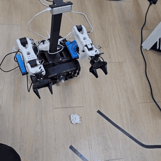
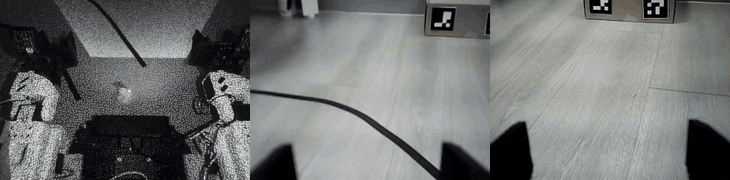

# SWEEPICK · 바닥 물체를 치우는 저비용 양팔 모바일 매니퓰레이터

한국어 · [English](README_EN.md)

청소를 시작하기 전에 바닥의 작은 물체부터 집어 옮기는 로봇을 만들었습니다. TurtleBot3 Waffle에 SO-101 양팔과 RGB-D 카메라, 손목 카메라를 달았습니다.

2026년 8~11월 동국대학교 DAPIER 1기 Physical AI 과정에서 4인 팀으로 개발했습니다. 이 저장소에는 양팔 코드, 시뮬레이션 데이터, ACT 학습·평가, 실물 연동 기록이 있습니다. 이동 베이스가 ROS 2로 양팔에 작업을 넘기는 과정도 기록했습니다. 이동 베이스의 Visual SLAM·Nav2·도킹 코드는 [팀원 저장소](https://github.com/shouttt1320/Dapier_project_visaul_slam)에서 볼 수 있습니다.

## 시뮬레이션 집기 평가

| 전체 평가 위치 | 학습에 쓰지 않은 Test 위치 |
|---|---|
| **132/143 (92.3%)** | **27/31 (87.1%)** |

전체 143곳 중 31곳은 학습에 쓰지 않은 Test 위치입니다. 학습 중에는 epoch 30 모델을 검증 위치 한 곳에서 먼저 돌려 봤습니다. 전체 평가에서는 이 모델을 고정하고 격자점 80곳(8×10)과 셀 중심 63곳(7×9)에서 한 번씩 실행했습니다. 시연이 없던 Train 위치에서도 21곳 중 17곳에서 작업을 마쳤습니다.

물체를 30 mm 이상 들어 올린 뒤 정리 자세(Stow)로 돌아오고, 들어 올린 높이와 접촉을 시뮬레이션 시간으로 2초간 유지하면 완료로 셌습니다. 물체 색, 배경과 테이블의 텍스처, 조명을 바꿨습니다. 물체 크기(40 mm), 수평 회전각(yaw), 물성, 카메라 보정값은 고정했습니다.

<p align="center">
  
</p>

<p align="center"><sub>최종 발표 시연(4배속) · <a href="https://julianjeonresume.netlify.app/assets/video/sweepick-real-full-run.mp4">원본 영상 62초</a> · <a href="https://julianjeonresume.netlify.app/#demo">로봇 시점 ACT 실행</a> · <a href="https://julianjeonresume.netlify.app/#projects">웹 포트폴리오</a></sub></p>

## 프로젝트에서 확인한 결과

| 영역 | 결과 |
|---|---|
| 전체 과정 (실물) | 2026-11-01, 로봇이 A 지점에 도착해 양팔 ACT로 물체를 집었습니다. B 지점으로 옮겨 놓고 HOME 자세로 돌아와 토크를 해제하기까지, 사람 개입 없이 처음 마쳤습니다. |
| 물체별 집기 (실물) | 최종 발표에서 물체마다 작업공간 안에서 10회씩 집어 봤습니다. 물체별 추가 파인튜닝 없이 3 cm 큐브는 7/10, 휴지는 8/10, 원형 고무는 7/10을 기록했습니다. |
| 학습 데이터 | SIM Expert로 얻은 성공 궤적 113개에서 외형을 각각 5종으로 바꿔 565뷰를 만들었습니다. 학습·검증·테스트에 궤적을 59/29/25개씩 배정하고, 같은 궤적의 외형 변형은 한 분할에 모았습니다. |
| 집기 판정·복구 (실물) | 저는 카메라로 집기를 판정하던 방식을 집게 서보 부하를 읽는 방식으로 바꿨습니다. 물체를 잡았을 때는 23–26 tick, 빈손일 때는 6–8 tick이었습니다. 빈손이면 팔을 자동으로 거둔 뒤 로봇이 다시 접근해 ACT를 시작하도록 구현했습니다. |
| 베이스↔로봇팔 인계 | `/task/ack` · `/task/command`(1회 10 cm·30° 제한) · `/sweepick/ready` · heartbeat 2 Hz, 팔 작업 중 차체 잠금 |
| 프로젝트 종료 시점에 남은 과제 | 실물에서 청소·도킹·충전을 연동하고, 같은 세팅에서 여러 번 실행해 성공률을 재는 일은 후속 과제로 남겼습니다. |

시뮬레이션과 실물은 각각 어떤 조건에서 실행했는지 함께 기록했습니다. 데이터 분할과 학습·실패 분석은 [CUSTOM ACT V1](docs/CUSTOM_ACT_V1_KO.md), 실물 연동과 결과별 조건은 [상세 기록](docs/PROJECT_DETAIL_KO.md)에 정리했습니다.

## 프로젝트에서 맡은 일

| 영역 | 참여 | 한 일 |
|---|---|---|
| SIM 데이터·도메인 랜덤화 | **주도** | RoboTwin에서 SIM Expert를 만들어 143개 위치에서 시연을 시도했습니다. 성공한 113개 궤적의 외형을 5종씩 바꿔 565뷰를 만들었습니다. 궤적 단위로 데이터를 나눈 뒤 관측과 행동이 맞는지 확인했습니다. Isaac Sim에서는 실물 작업 환경을 구성해 Sim-to-Real 적용을 시도했습니다. |
| 실물 Sim-to-Real 통합 | **주도** | 실물 집기 시연을 자동으로 만들고 녹화 기록을 ACT 학습용 에피소드로 변환했습니다. Native 자동 교사와 DAgger 전환도 구현했습니다. 로봇 제어·통신 점검용 대시보드를 만들고 관리했습니다. 화면에서 시작·정지 명령의 응답과 관절 목표값·실측값을 확인할 수 있게 했습니다. 실물 SO-101에는 MuJoCo 자코비안 기반 DLS 역기구학과 7차 시간 스케일링으로 만든 관절 궤적을 적용했습니다. 집게 부하로 집었는지 판단해 빈손이면 자동으로 거둬 다시 시도하도록 했고, 장애는 원인별로 처리했습니다. |
| 베이스↔로봇팔 ROS 2 연동 | **주도** | 베이스가 팔에 작업을 넘기는 토픽과 heartbeat 핸드셰이크를 설계했습니다. 이동 명령에 제한을 두고 팔이 작업하는 동안에는 차체를 잠갔습니다. |
| Custom ACT 학습·평가 | 공동 | 팀원 한 명과 Custom ACT를 200 epoch 학습했습니다. epoch 30 모델을 고정해 143개 위치에서 폐루프로 평가하고, 실패 11건을 나눠 살펴봤습니다. |
| Visual SLAM·Nav2·도킹·Qwen 명령 | 협업 | 이 기능들을 맡은 팀원과 재접근 한도와 정지 조건을 정해 집기 단계에 연결했습니다. |
| YOLO 인식 | 팀원 담당 | — |

설계·구현·검증을 맡은 일은 ‘주도’, 팀원과 나눠 진행한 일은 ‘공동’, 다른 담당자의 작업에 함께한 일은 ‘협업’으로 적었습니다. 공동·협업 항목은 팀 결과입니다.

## 시연 구성

```text
이동 베이스: A 지점으로 이동·정렬                (Visual SLAM·Nav2, 팀원 모듈)
  → 인계: /task/ack · /sweepick/ready, 팔 작업 중 차체 잠금
  → 양팔: 작업공간 RGB-D·양손목 RGB 관측 → ACT 집기 → 집게 부하로 집기 판정
          빈손이면 자동 회수 → 재접근 → ACT 재시작
  → 이동 베이스: B 지점으로 이동 → 양팔: 놓기
  → 양팔: HOME 복귀·토크 해제
```

<p align="center">
  
</p>

| 장치 | 역할 |
|---|---|
| TurtleBot3 Waffle | 이동 베이스. 전면 Astra RGB-D로 Visual SLAM·Nav2·도킹(팀원 모듈) |
| SO-101 양팔 (STS3215 서보) | ACT 집기·놓기, 집게 서보 부하로 집기 판정 |
| OS30A RGB-D | 작업공간 관측(깊이) |
| 양손목 RGB 카메라 | 집기 관측 |

전면 Astra는 이동에, OS30A는 작업공간 관측에 썼습니다. 날짜별 장비 구성은 [상세 기록의 장비 역할](docs/PROJECT_DETAIL_KO.md#장비-역할과-과거-설정)에 정리했습니다.

## 장비 없이 실행하는 테스트

아래 테스트로 관측 출처와 명령 형식·TTL, 지역화 상태, 깊이 기반 좌표 변환을 확인할 수 있습니다. 장치 연결 없이 실행됩니다.

```bash
git clone https://github.com/Alpenj/sweepick.git
cd sweepick
python3 -m unittest discover -s research/test -v
```

2026-11-03에 Windows·Python 3.14에서 33개 테스트가 통과했다. GitHub Actions는 `scripts/verify-hardware-free`(ShellCheck·bats·C++ 포함),
MuJoCo 헤드리스 검증, RoboTwin 데이터 계약 테스트를 실행한다.

> **`main` 코드의 실물 실행 상태 (2026-09-04 안전 고지 유지):** 이 저장소 `main`의 실행기에서 physical motion과 camera streaming은 local safety integration(connected-endpoint identity binding, 독립 device-side watchdog, 카메라 serial/cryptographic binding 확인)이 끝날 때까지 비활성화돼 있다. 실물 집기는 DAPIER의 [검토 브랜치](https://github.com/Alpenj/DAPIER/branches/all?query=sweepick)에 있는 별도 실행기(단일 owner·정지 조건·현장 승인)로 하며, 그 코드는 `main`에 병합하지 않았다.

실물 보정·제어 전에는 [하드웨어 안전 절차](docs/HARDWARE_SAFETY_KO.md)를 먼저 확인한다. 문서의 예시 명령은 실물 실행 승인이 아니다.

| 필요한 내용 | 안내 |
|---|---|
| 데이터 수집·분할·학습·SIM 평가·실패 분석 | [CUSTOM ACT V1](docs/CUSTOM_ACT_V1_KO.md) |
| 143개 위치별 결과 | [위치별 CSV](docs/evidence/custom_act_v1_20261027_positions.csv) · [조건·집계 JSON](docs/evidence/custom_act_v1_20261027_summary.json) |
| 실물 연동 기록·결과별 조건 | [상세 기록](docs/PROJECT_DETAIL_KO.md) |
| 접촉·미끄러짐·끝점 오차 연구 | [이전 조작 연구](docs/RESEARCH_SUMMARY_KO.md) |
| MuJoCo 양팔·이동 모델 | [mobile_dual_so101](sim/mobile_dual_so101/README.md) |
| Python 연구 계층과 관측 출처 계약 | [research](research/README.md) · [관측 출처](research/OBSERVATION_PROVENANCE.md) |
| C++ 코어와 ROS 2 노드 | [so101_ros2](so101_ros2/README.md) · [언어 간 계약](contracts/README.md) |
| 설계 결정 | [ARCHITECTURE](ARCHITECTURE.md) · [결정 기록(ADR)](docs/architecture/) |
| 전체 문서 | [문서 안내](docs/README.md) |

## 저장소 구조

| 경로 | 내용 |
|---|---|
| [research](research/README.md) | Python 연구 계층: 관측 출처, Sim-to-Real 데이터 게이트, 비전 타깃, 지역화 재생 |
| [sim](sim/mobile_dual_so101/README.md) | MuJoCo 양팔·이동 모델과 장면, SIM 데이터 수집·평가 |
| [src](src/shoe_sorting_data/README.md) | ROS 2 패키지 `shoe_sorting_data`: 데이터 계약과 작은 native ACT 구현(이전 단계) |
| [robotwin](robotwin/README.md) | RoboTwin 2.0 → Dual SO-101 에피소드 변환과 계약 테스트 |
| [so101_ros2](so101_ros2/README.md) | C++ 관절·지역화·안전 코어와 ROS 2 텔레옵 노드 |
| [contracts](contracts/README.md) | Python 연구 계층과 C++ 런타임 사이의 언어 중립 계약(JSON) |
| [config](config/) | 장치 역할, 원격 접속·학습 환경 템플릿 |
| [scripts](scripts/) · [test](test/) | 장비 없는 검증, MuJoCo 설정, 장치 점검 도구와 그 테스트 |
| [third_party](third_party/lerobot_v0_6_so101_mujoco/README.md) | LeRobot v0.6 SO-101 MuJoCo overlay (Apache-2.0) |
| [docs](docs/README.md) | 실험·설계 기록, 결정 기록, 그림·영상 |

개발 기준은 Ubuntu 24.04 · ROS 2 Jazzy · Python 3.12다. 데이터셋·모델 가중치·원시 영상·개인 보정값은 Git에 넣지 않는다.
외부 ACT·RoboTwin·LeRobot 구현과 자산은 각 폴더의 출처·라이선스를 따른다.

## 출처와 이력

2026-11-03에 [Alpenj/DAPIER](https://github.com/Alpenj/DAPIER)의 SWEEPICK 경로(`2ARM_ROBOT`, `so101_ros2`, `contracts` 등)를 옮겨 이 저장소를 만들었다.
개발 이력(커밋·PR)은 DAPIER에 그대로 있다: [2ARM_ROBOT 변경 이력](https://github.com/Alpenj/DAPIER/commits/main/2ARM_ROBOT) ·
[옮기기 직전 상태](https://github.com/Alpenj/DAPIER/tree/2399bfc531074f29e8c80905b6082b90f99cbd60/2ARM_ROBOT).
문서 안의 커밋·PR 링크와 기록된 실행 경로(`/home/.../DAPIER/...`)는 원래 저장소 기준이다. `2ARM_ROBOT`은 SWEEPICK의 이전 작업명이다.
