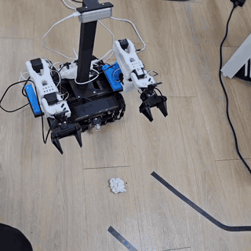

# SWEEPICK · A low-cost dual-arm mobile robot for clearing floor objects

[한국어](README.md) · English

We built SWEEPICK to pick up small objects from the floor before cleaning. Our four-person team worked on it from August to November 2026 in Dongguk University's DAPIER Physical AI program. We mounted two SO-101 arms, RGB-D cameras and wrist cameras on a TurtleBot3 Waffle.

This repository has the arm software, simulation data, ACT training and evaluation, and notes on hardware integration and the ROS 2 handoff. The base's Visual SLAM, Nav2 and docking code are in a [teammate's repository](https://github.com/shouttt1320/Dapier_project_visaul_slam).

## Simulation grasp evaluation

| All evaluated positions | Test positions held out from training |
|---|---|
| **132/143 (92.3%)** | **27/31 (87.1%)** |

Of the 143 evaluated positions, we kept 31 Test positions out of training. During training, we tried the epoch 30 model at one validation position. We then froze that model and ran it once at each of 80 grid points (8 × 10) and 63 cell centers (7 × 9). The robot also completed the task at 17 of 21 Train positions that had no demonstrations.

A run counted as complete when the robot lifted the object at least 30 mm, reached the stow pose and held the raised object in contact for two simulation seconds. We varied object color, background and tabletop textures, and lighting. Object size (40 mm), yaw, physics and camera calibration stayed fixed. [Evaluation details (Korean)](docs/CUSTOM_ACT_V1_KO.md) · [Position-by-position results](docs/evidence/custom_act_v1_20261027_positions.csv) · [Evaluation summary](docs/evidence/custom_act_v1_20261027_summary.json)

<p align="center">
  
</p>

<p align="center"><sub>Final demonstration (4× speed) · <a href="https://julianjeonresume.netlify.app/assets/video/sweepick-real-full-run.mp4">Original video, 62 seconds</a> · <a href="https://julianjeonresume.netlify.app/sweepick/">Portfolio case study</a></sub></p>

## Runs and results

| Area | Result |
|---|---|
| Full run on hardware | On November 1, 2026, the robot reached point A, picked up an object using the dual-arm ACT policy, carried it to point B, and placed it. It then returned to HOME and released torque. That was the first time it completed the full run without human intervention. |
| Hardware grasping by object | During the final presentation, we tried each object ten times in the robot's workspace. The robot picked up a 3 cm cube in 7/10 attempts, a tissue in 8/10 and a round rubber piece in 7/10, all without object-specific fine-tuning. |
| Training data | SIM Expert generated 113 successful trajectories. We created five appearances per trajectory for 565 views. We used 59 trajectories for training, 29 for validation and 25 for test, keeping all appearance variants of each trajectory together. |
| Grasp checks and recovery on hardware | I switched the grasp check from the camera to the gripper servo load. It read 23–26 ticks with an object and 6–8 ticks with an empty gripper. When the grasp was empty, the arms retracted automatically before the robot re-approached and restarted ACT. |
| ROS 2 handoff | `/task/ack`, `/task/command` (10 cm or 30° per command), `/sweepick/ready`, a 2 Hz heartbeat, and a base lock while the arms worked. |

At the end of the project, we still had to connect cleaning, docking and charging on hardware and measure the success rate across repeated runs with the same setup. [Hardware integration record (Korean)](docs/PROJECT_DETAIL_KO.md)

## What I worked on

| Area | Role | Work |
|---|---|---|
| Simulation data and domain randomization | Led | I built SIM Expert in RoboTwin and tried to generate demonstrations at 143 positions. I made appearance variants from the 113 successful trajectories and checked that observations and actions lined up. In Isaac Sim, I recreated the physical workspace to try Sim-to-Real transfer. |
| Sim-to-Real hardware integration | Led | I automated grasp demonstrations on the robot and turned the recordings into ACT training episodes. I built the native automatic teacher and DAgger handover. I also built and maintained a dashboard for robot control and communication checks. It showed start and stop responses and let me compare target and measured joint positions. I applied MuJoCo Jacobian-based damped least-squares inverse kinematics and seventh-order time scaling to the SO-101 arms. I used servo load to check the grasp and added retries when it failed. |
| ROS 2 base-to-arm handoff | Led | I designed the handoff topics, motion limits and heartbeat. I set the base to lock while the arms were working. |
| Custom ACT training and evaluation | Co-developed | A teammate and I trained ACT through 200 epochs. We evaluated the fixed epoch 30 model in a separate closed-loop test and classified the 11 failures. |
| Visual SLAM, Nav2, docking and Qwen commands | Collaborated | I worked with the teammate who owned those modules to set re-approach limits and stop conditions for the handoff to grasping. |
| YOLO detection | Teammate | A teammate owned this work. |

## Hardware-free checks

```bash
git clone https://github.com/Alpenj/sweepick.git
cd sweepick
python3 -m unittest discover -s research/test -v
```

On November 3, 2026, we ran these checks on Windows with Python 3.14 and 33 tests passed. GitHub Actions runs `scripts/verify-hardware-free`, headless MuJoCo checks and RoboTwin data-contract tests.

> **Hardware execution on `main` (September 4, 2026 safety notice):** Physical motion and camera streaming are disabled in the `main` executor pending local safety integration. The required checks cover connected-endpoint identity binding, an independent device-side watchdog, and camera serial/cryptographic binding. The physical runs used a separate executor from a [review branch in DAPIER](https://github.com/Alpenj/DAPIER/branches/all?query=sweepick), with a single owner, stop conditions and onsite approval. That executor was kept out of `main`.

Read the [hardware safety procedure (Korean)](docs/HARDWARE_SAFETY_KO.md) before hardware calibration or control. Example commands do not authorize hardware operation.

## Repository guide

| Find | Where |
|---|---|
| Data collection, splits, training, evaluation and failure analysis | [CUSTOM ACT V1 (Korean)](docs/CUSTOM_ACT_V1_KO.md) |
| Hardware roles and experiment-specific conditions | [Project details (Korean)](docs/PROJECT_DETAIL_KO.md) |
| Bimanual MuJoCo simulation | [Simulation](sim/mobile_dual_so101/README.md) |
| Python research code and observation provenance | [Research](research/README.md) · [Observation provenance](research/OBSERVATION_PROVENANCE.md) |
| C++ core, ROS 2 nodes and cross-language contracts | [so101_ros2](so101_ros2/README.md) · [Contracts](contracts/README.md) |
| Architecture and decision records | [Architecture](ARCHITECTURE.md) · [Decision records](docs/architecture/) |
| Documentation index | [Docs (Korean)](docs/README.md) |

SWEEPICK moved out of [Alpenj/DAPIER](https://github.com/Alpenj/DAPIER) on November 3, 2026. Earlier project history remains there under [2ARM_ROBOT](https://github.com/Alpenj/DAPIER/commits/main/2ARM_ROBOT).
